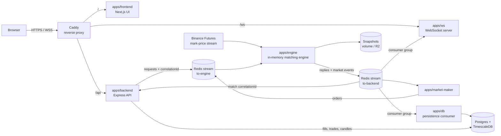

# Axiom

Axiom is a perpetual-futures crypto exchange built as a study project. It runs an in-memory matching engine with margin, liquidation, auto-deleveraging (ADL) and funding, and streams market data live over WebSockets. A REST API, the WebSocket service, a Postgres persistence consumer and a market maker all talk to the engine through Redis Streams.

> [!WARNING]
> Axiom is a personal prototype. Do not use it with real credentials or funds. Balances come from a demo on-ramp with no payment provider behind it, and prices come from Binance's public mark-price feed.

## Demo

https://github.com/user-attachments/assets/195d7f68-ce84-4af1-8b83-60ffa96271ca

## What it does

- **Matching engine** (`apps/engine`): price-time order books per market, built on `js-sdsl` `OrderedMap`. Supports `LIMIT` and `MARKET` orders, `LONG` and `SHORT`, on `BTCUSD`, `ETHUSD` and `SOLUSD`.
- **Margin and risk**: each order carries its own margin. The API rejects orders above the per-market leverage cap (BTC 75×, ETH 50×, SOL 20×). A position is liquidated once its unrealized loss reaches 95% of its margin. The engine first closes it against the book, then auto-deleverages any remainder against the most profitable opposite position at the mark price.
- **Funding**: settles every 8 hours (00:00, 08:00 and 16:00 UTC). The rate comes from the gap between the last traded price and the Binance mark price, capped at ±0.05%.
- **Recovery**: the engine snapshots its state, together with its Redis stream read position, every 3 seconds. It writes the snapshot to a Docker volume and, when R2 is configured, to an S3-compatible bucket. After a restart it replays the stream from that position.
- **Live data** (`apps/ws`): clients subscribe to depth, trades, last-traded price, mark price, funding, liquidations and candles. The service caps connections and drops clients that read too slowly.
- **Persistence** (`apps/db`): writes users, orders, fills and ticks to Postgres/TimescaleDB in batches, and builds 1m, 5m, 15m, 1h and 1d candles.
- **Market maker** (`apps/market-maker`): quotes 5 levels on each side of the mark price, re-quotes every second, and places a small market order every 2.5 seconds.
- **Trading UI** (`apps/frontend`): a Next.js app with a landing page, a markets overview, a trading screen with order book, chart and order entry, and a `/simulation` order load-test page.

## Tech stack

| Layer                | Technology                                                                |
| -------------------- | ------------------------------------------------------------------------- |
| Runtime and monorepo | Bun 1.3.13, Turborepo, TypeScript                                         |
| API                  | Express 5, `jsonwebtoken`, `bcryptjs`, Zod schemas shared across services |
| Messaging            | Redis 7 Streams (`redis` v5 client)                                       |
| Storage              | PostgreSQL 15 with TimescaleDB, Prisma 7 (`@prisma/adapter-pg`)           |
| Real time            | `ws` WebSocket server, Binance Futures mark-price stream                  |
| Frontend             | Next.js 16, React 19, Tailwind CSS 4, `lightweight-charts`, `motion`      |
| Infrastructure       | Docker Compose, Caddy 2, optional Cloudflare R2 (`@aws-sdk/client-s3`)    |

## Architecture

Services send every state change to the engine as a message on the `to-engine` stream. The engine is the only writer of exchange state. It publishes replies and market events to `to-backend`, which the API, WebSocket server, DB consumer and market maker each read independently.



1. `apps/backend` validates an HTTP request with Zod, adds it to `to-engine` with a `correlationId`, and waits up to 5 seconds for the matching reply on `to-backend`.
2. `apps/engine` reads `to-engine` in order, updates its order books, balances and positions, and publishes replies and market events to `to-backend`.
3. `apps/ws` reads `to-backend` through its own consumer group and sends each event only to clients subscribed to that stream. It keeps the last 200 candles per stream in memory, so a new subscriber gets recent history straight away.
4. `apps/db` reads `to-backend` through a separate consumer group and writes to Postgres in batches of up to 1,000 messages. It acknowledges each batch only after the write.
5. The engine's Binance listener turns `BTCUSDT`, `ETHUSDT` and `SOLUSDT` mark prices into `markprice_updated` events, which trigger liquidation checks.

## Requirements

- [Bun](https://bun.sh/) 1.3.13 (the `packageManager` version in `package.json`)
- Docker with the Compose plugin, for Postgres and Redis
- Outbound network access to `stream.binancefuture.com`. The engine waits for the Binance connection before it starts.

## Quick start

This path runs Postgres and Redis in Docker and every app on the host with hot reload. `docker-compose.yml` publishes Postgres and Redis on `127.0.0.1` so host processes can reach them.

1. Install dependencies and generate the Prisma client:

   ```bash
   bun install
   cp .env.example .env
   (cd packages/db && bun run prisma generate)
   ```

2. Edit `.env`. Set real values for `POSTGRES_PASSWORD` and `JWT_SECRET`, then point everything at host addresses:

   ```dotenv
   DATABASE_URL=postgresql://postgres:<POSTGRES_PASSWORD>@localhost:5432/postgres
   REDIS_URL=redis://localhost:6379
   CORS_ORIGINS=http://localhost:3000
   NEXT_PUBLIC_API_URL=http://localhost:3001
   NEXT_PUBLIC_WS_URL=ws://localhost:8080
   ```

3. Start Postgres and Redis, then apply the migrations:

   ```bash
   docker compose up -d postgres redis
   (cd packages/db && DATABASE_URL="postgresql://postgres:<POSTGRES_PASSWORD>@localhost:5432/postgres" bun run prisma migrate deploy)
   ```

4. Start the engine, API, WebSocket server, DB consumer, market maker and frontend:

   ```bash
   bun run dev
   ```

   `bun run dev` loads the root `.env` and passes it through Turborepo. The frontend runs on `http://localhost:3000`, the API on port `3001` and the WebSocket server on port `8080`.

5. Check the API and create a user:

   ```bash
   curl -s http://localhost:3001/healthz
   # {"ok":true}

   curl -s -X POST http://localhost:3001/signup \
     -H 'Content-Type: application/json' \
     -d '{"email":"alice@example.com","password":"use-a-local-test-password"}'
   ```

   The signup response contains a JWT. Send it as `Authorization: Bearer <token>`, and call `POST /onramp` to add a demo balance before you place orders.

## Running the full stack with Docker Compose

Compose builds one image (`Dockerfile`) and runs every service in it, behind Caddy on ports 80 and 443:

```bash
docker compose build --pull
docker compose up -d postgres redis
docker compose run --rm -w /app/packages/db db-consumer \
  bun run prisma migrate deploy
docker compose up -d
```

Only Caddy (and Postgres and Redis on loopback) publishes ports. The committed `Caddyfile` serves `exchange.deepanshu.live` and `exchange-api.deepanshu.live` only. To reach the stack under any other hostname, change the site addresses in `Caddyfile`. `NEXT_PUBLIC_API_URL` and `NEXT_PUBLIC_WS_URL` are built into the frontend bundle at build time, so rebuild the `frontend` image whenever they change. [`DEPLOYMENT.md`](./DEPLOYMENT.md) covers the full single-VM deployment on GCP, including Cloudflare DNS, verification and updates.

## Configuration

[`.env.example`](./.env.example) lists every variable. The main groups:

| Group                    | Variables                                                                                                                                           |
| ------------------------ | --------------------------------------------------------------------------------------------------------------------------------------------------- |
| Database and Redis       | `DATABASE_URL`, `REDIS_URL`, `POSTGRES_USER`, `POSTGRES_PASSWORD`, `POSTGRES_DB`                                                                    |
| Auth and browser routing | `JWT_SECRET` (required), `JWT_EXPIRES_IN` (default `7d`), `CORS_ORIGINS`, `NEXT_PUBLIC_API_URL`, `NEXT_PUBLIC_WS_URL`                               |
| Simulation routes        | `ENABLE_SIM_ROUTES` (default `false`)                                                                                                               |
| Streams and consumers    | `ENGINE_STREAM`, `BACKEND_STREAM`, `WS_CONSUMER_GROUP`, `WS_CONSUMER_NAME`, `DB_CONSUMER_GROUP`, `DB_CONSUMER_NAME`, `BACKEND_MAX_PENDING_REQUESTS` |
| Prices and snapshots     | `BINANCE_STREAM_URL`, `SNAPSHOT_DIR`, optional `R2_ENDPOINT`, `R2_ACCESS_KEY_ID`, `R2_SECRET_ACCESS_KEY`, `R2_BUCKET_NAME`                          |
| Market maker             | `MM_INITIAL_BALANCE`, `MM_MIN_BALANCE`, `MM_REQUOTE_INTERVAL_MS`, `MM_BALANCE_CHECK_INTERVAL_MS`                                                    |
| Limits and retention     | `ENGINE_MAX_IN_MEMORY_FILLS`, `ENGINE_MAX_OPEN_ORDERS`, `WS_MAX_CLIENTS`, `WS_MAX_BUFFERED_BYTES`, `HISTORY_RETENTION_DAYS`                         |

## HTTP API

Express serves its routes from `/`. Behind Caddy they sit under `/api`, and Caddy strips that prefix. Market IDs are `BTCUSD`, `ETHUSD` and `SOLUSD`.

| Method | Path                                                                    | Auth   | Purpose                                                                                   |
| ------ | ----------------------------------------------------------------------- | ------ | ----------------------------------------------------------------------------------------- |
| `GET`  | `/healthz`                                                              | None   | Liveness check                                                                            |
| `POST` | `/signup`, `/signin`                                                    | None   | `{ "email", "password" }` → JWT                                                           |
| `POST` | `/change-password`                                                      | Bearer | `{ "currentPassword", "newPassword" }`                                                    |
| `POST` | `/onramp`                                                               | Bearer | Add a demo balance through the engine                                                     |
| `POST` | `/order`                                                                | Bearer | Place a `LIMIT` or `MARKET` order with `qty`, `price`, `market`, `type`, `kind`, `margin` |
| `POST` | `/order/cancel`                                                         | Bearer | Cancel by `orderId`                                                                       |
| `GET`  | `/equity/available`                                                     | Bearer | Available balance                                                                         |
| `GET`  | `/positions/open/:marketId`, `/orders/open/:marketId`                   | Bearer | Open positions and orders (`:marketId` may be `all`)                                      |
| `GET`  | `/fills`                                                                | Bearer | Your latest 200 fills, from Postgres                                                      |
| `GET`  | `/depth/:marketId`, `/ticker/price/:marketId`, `/ticker/mark/:marketId` | None   | Order book and prices                                                                     |
| `GET`  | `/trades/:marketId`, `/liquidations/:marketId`                          | None   | Recent trades and liquidations                                                            |
| `GET`  | `/candles/:marketId/:interval`                                          | None   | Candles for `1m`, `5m`, `15m`, `1h` or `1d`                                               |
| `POST` | `/sim/provision`, `/sim/inject-mark-price`                              | None   | Simulation helpers. They return `403` unless `ENABLE_SIM_ROUTES=true`                     |

For a `MARKET` order, `price` is the worst price you will accept. The UI and the market maker send the best price ±1%. `/fills` reads from Postgres, so it can trail the engine by one consumer batch. The simulation routes create funded users and can move the mark price, which liquidates real positions, so keep them disabled on any public deployment.

## WebSocket subscriptions

Send `SUBSCRIBE` or `UNSUBSCRIBE` with a list of stream names. The server answers with `{ "result": null, "id": ... }`.

```json
{
  "method": "SUBSCRIBE",
  "params": ["depth.BTCUSD", "trade.BTCUSD", "candle.BTCUSD.1m"],
  "id": 1
}
```

The available streams are `depth.<market>`, `trade.<market>`, `lastTradedPrice.<market>`, `markPrice.<market>`, `funding.<market>`, `liquidation.<market>` and `candle.<market>.<interval>`, where `<interval>` is `1m`, `5m`, `15m`, `1h` or `1d`.

## Development

Run these from the repository root:

```bash
bun run dev          # every service, through Turborepo
bun run build        # build tasks
bun run lint         # configured linters
bun run check-types  # tsc --noEmit in every workspace
bun run format       # Prettier on TypeScript and Markdown
```

There is no automated test suite. `check-types` is the static check. For load, `scripts/stress-benchmark.ts` provisions simulation users, calls the API routes, and writes `scripts/stress-benchmark-results.json`. It needs a backend started with `ENABLE_SIM_ROUTES=true`:

```bash
bun scripts/stress-benchmark.ts   # API_BASE (default http://localhost:3001), CONCURRENCY, REQUESTS
```

## Operational limits

- The Redis streams are trimmed to about 100,000 entries (approximate `MAXLEN`). The backend rejects new engine requests once 10,000 are pending (`BACKEND_MAX_PENDING_REQUESTS`).
- The engine keeps at most 100,000 fills and 100,000 resting orders in memory by default (`ENGINE_MAX_IN_MEMORY_FILLS`, `ENGINE_MAX_OPEN_ORDERS`).
- The WebSocket server accepts 1,000 clients by default and disconnects any client whose buffer grows past `WS_MAX_BUFFERED_BYTES`.
- TimescaleDB keeps raw ticks and 1m candles for 30 days, 5m candles for 90 days, 15m candles for 180 days and 1h candles for 730 days. Daily candles are kept forever. The DB consumer deletes fills and finished orders older than `HISTORY_RETENTION_DAYS` (default 90).
- Passwords are hashed with bcrypt, and older plain-text passwords are re-hashed at the next login. A JWT cannot be revoked before it expires, and changing a password does not end existing sessions. There is no password-reset flow.
- Funding boundaries that pass while the engine is down are skipped.
- Engine snapshots restore engine state only. Back up Postgres separately.

## Repository layout

| Path                    | Contents                                                                    |
| ----------------------- | --------------------------------------------------------------------------- |
| `apps/engine`           | Matching engine, position and balance managers, Binance listener, snapshots |
| `apps/backend`          | Express API and the Redis request/reply bridge to the engine                |
| `apps/ws`               | WebSocket server, subscription fan-out, live candle state                   |
| `apps/db`               | Stream consumer, batched Postgres writes, candles, retention                |
| `apps/market-maker`     | Quoting and taker strategy for each market                                  |
| `apps/frontend`         | Next.js trading UI                                                          |
| `packages/shared-types` | Zod schemas and event types shared across services                          |
| `packages/db`           | Prisma schema, client and migrations                                        |
| `packages/redis`        | Shared Redis client                                                         |
| `packages/types`        | UI types for the frontend (`@repo/types`)                                   |
| `scripts`               | API stress benchmark                                                        |
